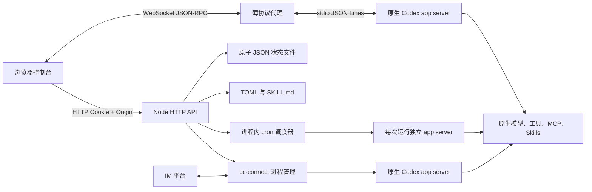

# 架构

## 边界

- `server/app.js`：HTTP 认证、Origin 验证、管理路由、静态文件、WebSocket 升级与转发。
- `server/runtime.js`：app-server 子进程、stdio 帧、请求关联、初始化、超时和进程组关闭。
- `server/store.js`：串行状态变更、写临时文件后原子 rename，写入失败时保留上一份内存状态。
- `server/settings.js`：通用配置、代理环境变量、任务默认时区与并发上限的持久化；设置用于后续新进程。
- `server/resources.js`：目录 canonical path 校验、TOML / MCP / Skills 文件管理、revision 冲突检测。
- `server/skills-zip.js`：有界 ZIP 导入、CRC 校验、技能包替换与上一版本备份；不执行包内脚本。
- `server/scheduler.js`：cron、并发 / 重叠保护、任务级环境变量、无人值守原生 turn、超时 / 中断及最终记录。
- `server/bridge.js`：cc-connect 启停、有界日志和退出状态；没有重新实现 IM 协议。
- `public/`：静态 HTML / CSS 与浏览器 ESM，所有动态文本先转义；纯文本和可展开 JSON 渲染原生内容。

没有模型 API 代理、独立工具注册层或额外 Agent SDK。原生 app-server 自己处理工具循环、web search、MCP 和模型上下文。IM 模板显式选择 cc-connect 的 app_server / stdio 后端，由 cc-connect 管理 IM 对应的原生进程与审批；用户提供的既有配置也可使用其 exec 后端。

## 数据与生命周期

每个浏览器连接只拥有一个 app-server，互不复用请求 ID 空间。Deck 内部请求使用 `deck:` 前缀，浏览器不能占用此前缀；服务端发起的请求原样转给浏览器，不自动批准。连接关闭时结束自有进程组，不连接桌面 App 的已有后台进程。

浏览器管理页导航不关闭 WebSocket；页面刷新或切换工作目录会关闭。线程由原生 Codex 存储，可在新连接恢复。会话实时计算状态不落 Deck 自己的数据库。

定时任务拥有与浏览器独立的原生进程，因此浏览器关闭不影响执行。任务完成后保存最终文本与原生 thread ID；工具中间产物由 Codex / 文件系统保存。日志和运行记录有界，但原生 Codex 线程与工作区文件不做自动清理。

## 单实例约束

JSON 文件写入队列只覆盖同一 Node 进程。多个 Deck 实例共享一个卷会产生写入冲突和重复调度，因此一个数据目录只能由一个 Deck 服务实例使用。后续需要多用户或横向扩展时应显式引入服务端身份体系、租户隔离和带事务 / 锁的存储。

管理文件的 revision 检测用于多个管理页面和外部编辑器的冲突提醒。外部进程在最后检查与写入之间仍可能竞态修改同一文件；配置变更应集中通过 Deck，修改原生配置后建立新连接。MCP 编辑器会重排 TOML 且移除注释，但保留其他键，并保留 `.bak`。

## 发布

PR / main CI 在 Node 22 / 24 上执行检查与测试，另构建容器并运行内置 CLI 版本和健康检查。发布 workflow 先执行测试，再登录 Docker Hub 并用 Buildx 发布两个架构，不在本地构建时注入任何账号密钥。
